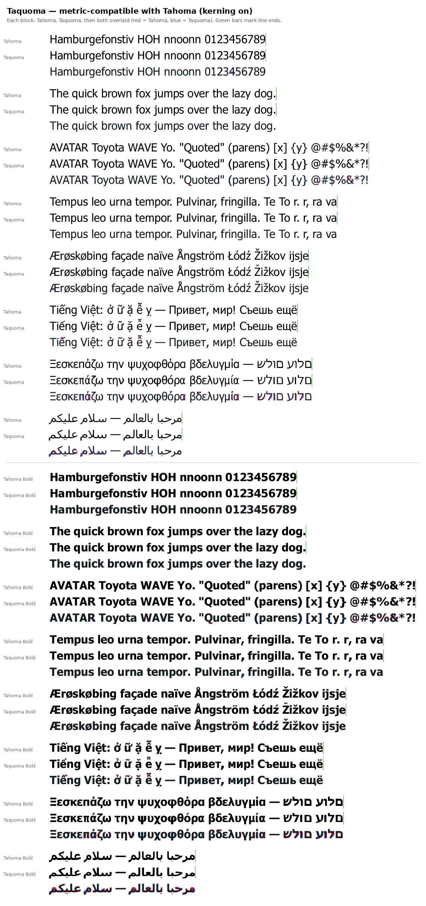

# Taquoma

Taquoma is [Fauxdana](https://github.com/muglug/fauxdana) refitted to be
metric-compatible with Tahoma. Text set in it takes up the same space as the
same text set in Tahoma, so swapping one for the other causes no layout
shift. Advance widths, line height and glyph positions all match, and the
character set is Tahoma's.

## How to build

You need Python 3 with `fonttools`, `skia-pathops`, `ttfautohint-py`,
`freetype-py` (used to check the hinting) and `brotli`. For checking, also
install `uharfbuzz`, `pillow` and `numpy`. `requirements.txt` pins the
versions these fonts were built with. The inputs are:

- the Fauxdana TTFs
- DejaVu Sans 2.37, the release Fauxdana was built from (used for the
  Arabic tables and for where accents sit on their letters)

Then:

    pip install -r requirements.txt
    scripts/build.sh /path/to/fauxdana/ttfs /usr/share/fonts/truetype/dejavu

This writes `ttfs/Taquoma-{Regular,Bold}.ttf` and `webfonts/*.woff2`. Builds
are reproducible: the same inputs and tool versions give byte-identical
fonts. Other versions of the tools give the same glyphs, widths and layout
tables, but may store a table's bytes in a different order (fontTools 4.68,
for example, orders the GSUB table differently).

To re-measure from a Tahoma you have, and to check a build:

    python3 scripts/extract_metrics.py Tahoma.ttf TahomaBd.ttf tahoma-metrics.json
    python3 scripts/verify.py Tahoma.ttf ttfs/Taquoma-Regular.ttf --source /path/to/Fauxdana-Regular.ttf
    python3 scripts/render.py compare.png 40 "Tahoma=Tahoma.ttf" "Taquoma=ttfs/Taquoma-Regular.ttf" --overlay

`verify.py` exits non-zero if any layout check fails.

## Testing on your own systems

`tests/layout-test.html` runs the browser comparison in any browser. It uses
the Tahoma installed on the computer, or `Tahoma.ttf` and `TahomaBd.ttf`
placed in `tests/`. Browsers don't load fonts from `file://` pages, so serve
the repository:

    python3 -m http.server 8000      # in the repository's top folder

Then open <http://localhost:8000/tests/layout-test.html>. The page reports
PASS or FAIL (judged with kerning on, kerning off, and kerning and ligatures
off) and lists any differing words.

## Licence

Taquoma is distributed under the SIL Open Font License 1.1, like Fauxdana;
see `LICENSE`. It is derived from DejaVu Sans (Bitstream Vera and Arev). The
notices for those fonts stay embedded in each font and are reproduced in
`LICENSE-DejaVu.txt`. Tahoma is a trademark of Microsoft, and Taquoma is not
affiliated with or endorsed by Microsoft.
